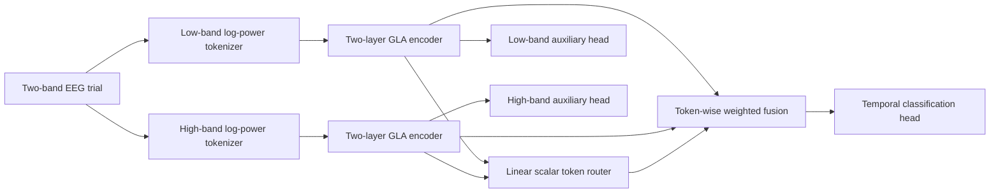

# Architecture

The public model is `eegcrossformer.EEGCrossformer`. Protocol entries provide the input shape and training transforms; every entry uses the shared 300 ms receptive-field / 100 ms hop tokenizer grid, resolved in samples for its sampling rate ([tokenizer_geometry.md](tokenizer_geometry.md)). The input is a filtered two-band EEG tensor `[B,2,C,T]`.



For each token, the sigmoid gate weights one branch and its complement weights the other. Fusion preserves the token sequence and passes directly into the main classification path without a fusion LayerNorm. Normalization inside tokenization, encoders, and auxiliary heads remains part of the model. The main head uses a constrained temporal convolution; auxiliary heads use temporal mean pooling, LayerNorm, and an MLP.

Gain RTUR uses a frozen EMA copy of the student. It searches a candidate token gate around each trial's mean gate, keeping the candidate perturbation zero-sum and within its radius. The teacher's classification utility improvement sets the supervision confidence. The shape loss guides the student's token routing; candidate optimization and confidence calculation do not backpropagate through the teacher or the branch features.

## Training framework

`cli.py` resolves one of five entries. Its protocol base handles cohort selection, splits, data loaders, checkpoint selection, and result aggregation. `FinalRecipeMixin` constructs the public model and the shared RTUR task, then wraps them in `LightningModelWrapper`.

The task applies training/evaluation batch transforms, computes main and auxiliary CE, schedules Gain RTUR, and updates the EMA teacher once per optimizer update. Monitoring records per-step and per-epoch statistics. A dedicated probe model evaluates a fixed training subset with deterministic transforms so probe forwards do not mutate the live student's state or random stream.

`gla` uses the Flash Linear Attention backend for the main experiments. `gla_cpu` is an explicit functional backend for validation. It is never selected automatically by a GPU entry.

## Public model output

With `return_feat=True`, the model returns:

```text
(main_logits, low_logits, high_logits,
 low_tokens, high_tokens, fused_tokens, refined_fused_tokens, gate)
```

With `return_feat=False`, it returns `main_logits`. Classification has two classes for BCIC/OpenBMI and five for SEED-V.

The model, its EMA teacher, and the Gain RTUR objective are defined in `src/eegcrossformer/models/eegcrossformer.py`; `experiments/utils/gain_rtur_task.py` binds them to the training loop. Module and parameter names follow the research implementation, so archived checkpoints load with `strict=True`.
